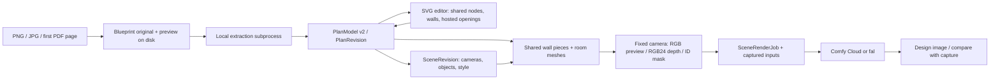

# Florp architecture — implementation audit

Audited 7 November 2026 against main after PR #52 (`85d5f31`). This describes
implemented behavior, not measured architectural accuracy or production readiness.
The delivery contract is [the production POC plan](PRODUCTION_POC_PLAN.md), covering
[issue #1](https://github.com/BeBarefoot/Florp/issues/1).

## Current runtime and data flow

Next.js 15 / React 19 serves the editor; React Three Fiber 9 / Three.js renders scenes.
FastAPI validates requests with Pydantic; SQLModel persists SQLite records; files
live on local disk. This is a local, single-user development architecture. It is
not a deployed multi-tenant service. Never expose its current API publicly as-is.

## Source of truth and boundaries

| Concern | Current implementation and contract |
|---|---|
| User workspace | `/blueprint/[id]` re-exports `/plan/[id]`; both use `PlanEditor`. `/blueprint/[id]/legacy` remains separate. |
| Architecture | `app/plan_model.py`: PlanModel v2, image-space shared nodes, wall edges/thickness, wall-hosted openings, derived rooms, stairs, optional outline and room zones. |
| Metric scale | A confirmed reference derives meters per pixel. Without a reference the model clears metric scale. Heights/sills can still be editable assumptions; calibration does not verify architecture. |
| Geometry persistence | `PlanRevision` is append-only, unique per blueprint/revision; expected-revision conflicts return 409. `plan_api.py` validates, derives and stores models. |
| Extraction | `/blueprints/{bid}/plan/extract` invokes `workspace_worker.py` in an isolated subprocess with a 20-second budget. Default is local image evidence, structural runs, openings and reconstruction. Optional semantic configuration selects another path. YOLO/Yytsi comparison endpoints are separate research flows, not the default universal engine. |
| Optional fixtures | `fixture_detection.py` is the default local matcher; `FIXTURE_YOLO_WEIGHTS` selects `fixture_weights.py` with trusted local weights. Results require individual review; axis-aligned boxes do not establish orientation. |
| Scene persistence | `SceneRevision` references a plan revision and stores cameras, objects, style and dismissals separately from architectural geometry. Scene saves require calibration. |
| 3D | `lib/plan/mesh.ts`, `derive.ts` and `SceneMesh.tsx` derive wall chunks, joins, opening cuts and floors from the same PlanModel. Client edits, Python exports and derived geometry have separate implementations and require parity tests. |
| Capture | `SceneMesh.tsx` uses the saved camera at a fixed 1024×768 frame. Outputs include RGB preview, packed RGB24 view-space millimetres and object/structural IDs. `depth.py` converts depth into provider control. Normals are not part of this capture contract. |
| Render jobs | `/blueprints/{bid}/renders` saves scene/plan references, prompt and captured inputs; request keys prevent duplicate requests for identical inputs. Provider submission happens during the HTTP request; a bounded local API background task resumes receipt polling after restart, with browser GET polling also supported. Conditional status updates prevent stale polls from downgrading completed jobs. Initial submission still happens in the HTTP request; this is not a durable submission queue. |
| Providers | `comfy.py` implements Comfy Cloud v2 submission/polling; `providers.py` supplies fal. Server credentials, account credits and available models are required. Tests mock external services. Depth conditions images; it does not guarantee pixel-exact geometry. |
| Other models | Legacy `Layout`, `PlanGraphRevision`, `WorkspaceRevision`, training and deterministic-blueprint services coexist. They must not independently overwrite the homeowner PlanModel. Consolidation/migration is planned, not complete. |

## Verified evidence and limits

PR #52 passed GitHub backend, frontend build/typecheck and browser workflow.
Local evidence on that change: 405 Python tests passed, 1 skipped; 34 browser
tests passed. These are engineering regressions, largely synthetic/mocked.
They do not establish accuracy on held-out full plans, physical measurement
fidelity, image provider account availability or generated-image consistency.

The shared graph, derived rooms, revisions and render pipeline are implemented.
Do not describe them as absent. Conversely, there is no single persisted,
server-enforced architecture-verification state that gates every downstream
operation. Opening approval, scale validation and review findings are pieces
of that policy; they are not a release certification.

## Required production changes

1. Keep PlanModel v2 as the homeowner authority. Treat other extraction schemas as
   adapters/proposals with explicit coordinate and provenance conversion.
2. Add revision-specific verification and invalidation after edits; separate
   architectural acceptance, metric calibration and assumed elevations.
3. Persist upload identity/transforms and model/checkpoint/config provenance through
   extraction, correction, evaluation and export. Audit coverage end to end.
4. Introduce durable extraction/render jobs with bounded concurrency, worker leases,
   restart reconciliation and provider idempotency. A database row alone does not
   make execution durable. Ambiguous paid submissions need reconciliation, not retries.
5. Before hosted access, add authentication, project authorization, secrets management,
   upload/resource limits, migrations, backup/restore, retention/deletion and telemetry.
   PostgreSQL/object storage are the intended hosted replacements for SQLite/disk;
   local single-user mode may retain its current storage.
6. Keep geometry locks as input/provenance invariants. Add output consistency checks
   and review; never advertise a generative provider as a geometry guarantee.

This direction is coherent for the POC. A framework rewrite or new model training
is not justified before measured failures identify a need. The roadmap specifies
how to prove or reject the current approach.
